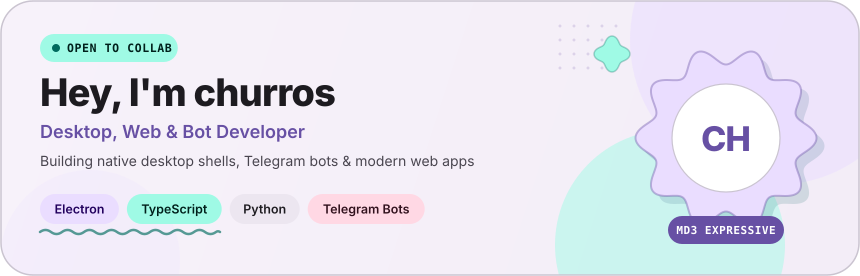
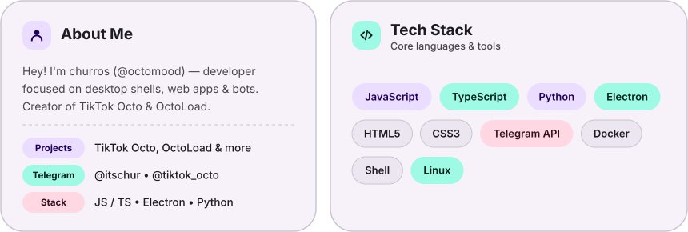
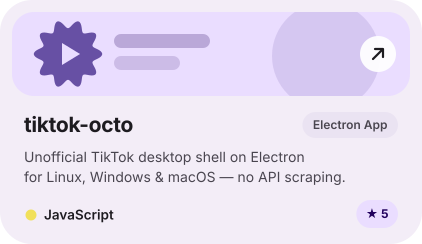
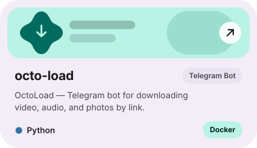
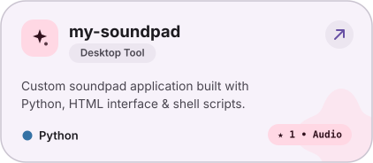
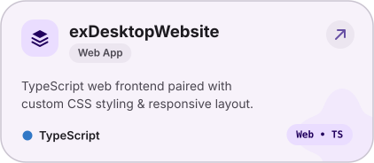
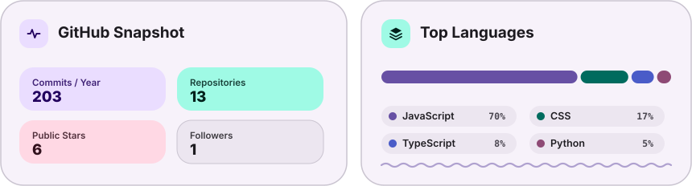

  <picture>
    <source media="(prefers-color-scheme: dark)" srcset="./assets/hero-dark.svg" />
    <source media="(prefers-color-scheme: light)" srcset="./assets/hero-light.svg" />
    
  </picture>

  <picture>
    <source media="(prefers-color-scheme: dark)" srcset="./assets/about-stack-dark.svg" />
    <source media="(prefers-color-scheme: light)" srcset="./assets/about-stack-light.svg" />
    
  </picture>

  <a href="https://github.com/octomood/tiktok-octo">
    <picture>
    <source media="(prefers-color-scheme: dark)" srcset="./assets/project-1-dark.svg" />
    <source media="(prefers-color-scheme: light)" srcset="./assets/project-1-light.svg" />
    
  </picture>
  </a>
  &nbsp;
  <a href="https://github.com/octomood/octo-load">
    <picture>
    <source media="(prefers-color-scheme: dark)" srcset="./assets/project-2-dark.svg" />
    <source media="(prefers-color-scheme: light)" srcset="./assets/project-2-light.svg" />
    
  </picture>
  </a>

  <a href="https://github.com/octomood/my-soundpad">
    <picture>
    <source media="(prefers-color-scheme: dark)" srcset="./assets/project-3-dark.svg" />
    <source media="(prefers-color-scheme: light)" srcset="./assets/project-3-light.svg" />
    
  </picture>
  </a>
  &nbsp;
  <a href="https://github.com/octomood/exDesktopWebsite">
    <picture>
    <source media="(prefers-color-scheme: dark)" srcset="./assets/project-4-dark.svg" />
    <source media="(prefers-color-scheme: light)" srcset="./assets/project-4-light.svg" />
    
  </picture>
  </a>

  <picture>
    <source media="(prefers-color-scheme: dark)" srcset="./assets/stats-dark.svg" />
    <source media="(prefers-color-scheme: light)" srcset="./assets/stats-light.svg" />
    
  </picture>

  <a href="https://github.com/octomood">
    <picture>
    <source media="(prefers-color-scheme: dark)" srcset="./assets/social-1-dark.svg" />
    <source media="(prefers-color-scheme: light)" srcset="./assets/social-1-light.svg" />
    
  </picture>
  </a>
  &nbsp;
  <a href="https://t.me/itschur">
    <picture>
    <source media="(prefers-color-scheme: dark)" srcset="./assets/social-2-dark.svg" />
    <source media="(prefers-color-scheme: light)" srcset="./assets/social-2-light.svg" />
    
  </picture>
  </a>
  &nbsp;
  <a href="https://t.me/tiktok_octo">
    <picture>
    <source media="(prefers-color-scheme: dark)" srcset="./assets/social-3-dark.svg" />
    <source media="(prefers-color-scheme: light)" srcset="./assets/social-3-light.svg" />
    
  </picture>
  </a>

  <picture>
    <source media="(prefers-color-scheme: dark)" srcset="./assets/footer-dark.svg" />
    <source media="(prefers-color-scheme: light)" srcset="./assets/footer-light.svg" />
    
  </picture>

