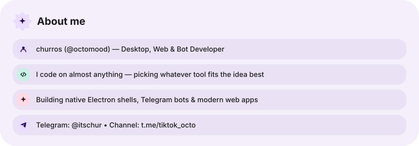
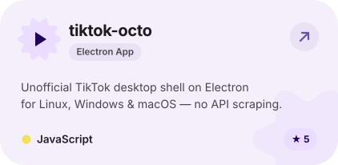
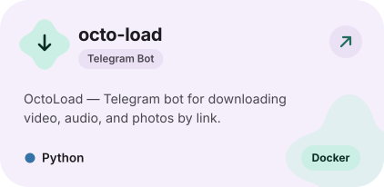
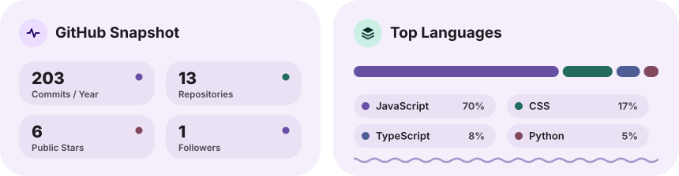

  <picture>
    <source media="(prefers-color-scheme: dark)" srcset="./assets/v3/hero-dark.svg" />
    <source media="(prefers-color-scheme: light)" srcset="./assets/v3/hero-light.svg" />
    
  </picture>

  <a href="https://github.com/octomood"><picture>
    <source media="(prefers-color-scheme: dark)" srcset="./assets/v3/social-1-dark.svg" />
    <source media="(prefers-color-scheme: light)" srcset="./assets/v3/social-1-light.svg" />
    
  </picture></a>
  &nbsp;
  <a href="https://t.me/itschur"><picture>
    <source media="(prefers-color-scheme: dark)" srcset="./assets/v3/social-2-dark.svg" />
    <source media="(prefers-color-scheme: light)" srcset="./assets/v3/social-2-light.svg" />
    
  </picture></a>
  &nbsp;
  <a href="https://t.me/tiktok_octo"><picture>
    <source media="(prefers-color-scheme: dark)" srcset="./assets/v3/social-3-dark.svg" />
    <source media="(prefers-color-scheme: light)" srcset="./assets/v3/social-3-light.svg" />
    
  </picture></a>

  <picture>
    <source media="(prefers-color-scheme: dark)" srcset="./assets/v3/about-dark.svg" />
    <source media="(prefers-color-scheme: light)" srcset="./assets/v3/about-light.svg" />
    
  </picture>

  <a href="https://github.com/octomood/tiktok-octo"><picture>
    <source media="(prefers-color-scheme: dark)" srcset="./assets/v3/project-1-dark.svg" />
    <source media="(prefers-color-scheme: light)" srcset="./assets/v3/project-1-light.svg" />
    
  </picture></a>
  &nbsp;
  <a href="https://github.com/octomood/octo-load"><picture>
    <source media="(prefers-color-scheme: dark)" srcset="./assets/v3/project-2-dark.svg" />
    <source media="(prefers-color-scheme: light)" srcset="./assets/v3/project-2-light.svg" />
    
  </picture></a>

  <picture>
    <source media="(prefers-color-scheme: dark)" srcset="./assets/v3/stats-dark.svg" />
    <source media="(prefers-color-scheme: light)" srcset="./assets/v3/stats-light.svg" />
    
  </picture>

  <picture>
    <source media="(prefers-color-scheme: dark)" srcset="./assets/v3/footer-dark.svg" />
    <source media="(prefers-color-scheme: light)" srcset="./assets/v3/footer-light.svg" />
    
  </picture>

